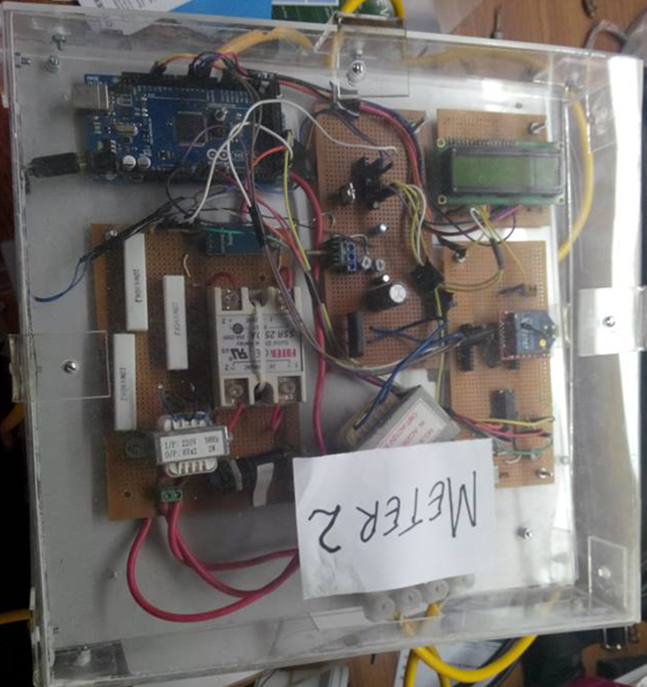
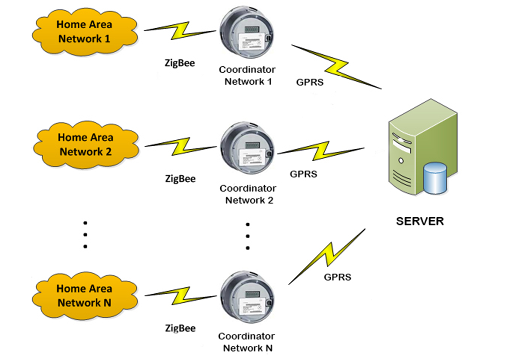

# Automatic Metering Infrastructure (AMI)
### Low-cost smart energy meters with an XBee mesh + GPRS network

Final year project (BS Electronic Engineering, GIK Institute, 2016): a single-phase digital energy meter
built on Arduino that measures voltage, current, frequency, power and energy, shows them on an LCD,
and reports to a utility server over an **XBee (DigiMesh) private area network** with a **GPRS** uplink.
The goal was remote monitoring and billing, power-theft detection and street-level load control.

`Arduino Mega` · `ACS712 current sensor` · `XBee / DigiMesh` · `SIM900D GPRS` · `C# control-unit GUI`



## System architecture



| Layer | Implementation |
|-------|----------------|
| Meter | Arduino Mega, 220 V to 8 V transformer + divider for voltage, ACS712 for current, 16x2 LCD |
| Local network | XBee modules in a DigiMesh private area network (several meters per coordinator) |
| Backhaul | GPRS (SIM900D) from the coordinator to the server |
| Utility software | C# Windows GUI: meter lookup, billing, theft check, street enable/disable, customer SMS (screenshots in `docs/images/gui/`) |

Measured per meter: RMS voltage, RMS current, frequency, real power, power factor, kWh. Three
meters were built and networked for the demonstration. Full design and results: [`docs/report/`](docs/report/Advanced-Metering-Infrastructure.pdf).

## Repository layout

```
firmware/
  ami_meter/          final meter firmware (Mega + XBee + LCD), from the report appendix
  prototype_meter/    first Uno-based measurement prototype
  bringup_tests/      small sketches used to check voltage, current, frequency, phase on the bench
  legacy_prototype/   an older draft (does not compile; kept for history)
tests/host/           PC-side tests: simulated mains signal + mocked Arduino/XBee/LCD/EEPROM
docs/                 report, presentations, posters, datasheets, photos, notes
docs/KNOWN_ISSUES.md  defects found in the original code
```

## Running the tests (no hardware needed)

The sketches are compiled as plain C++ against small mocks, driven by a simulated sine wave
with a virtual clock. Requires Python 3 and a C++17 compiler (`g++`/`clang++`, or `pip install ziglang`).

```bash
python tests/host/run_tests.py
```

Current result:

```
prototype_meter.ino   6 passed, 2 known-bug (xfail), 0 failed
ami_meter.ino        11 passed, 1 known-bug (xfail), 0 failed
```

What this shows: the sketches compile, frequency measurement (50/60 Hz), RMS current, kWh integration
and the XBee frame build all behave as intended in simulation. The `xfail` cases are real bugs in the
original code, listed in [docs/KNOWN_ISSUES.md](docs/KNOWN_ISSUES.md) (for example the voltage scale
`357/1023` evaluating to 0, and an incorrect power-factor formula).

> **Not tested on hardware.** The host tests do not model analog front-end accuracy, XBee radio or
> GPRS. Flashing needs the Arduino IDE with the `XBee` library (andrewrapp/xbee-arduino) and the
> built-in `LiquidCrystal` and `EEPROM` libraries, on an Arduino Mega 2560.

## Notes on the code

`firmware/ami_meter/ami_meter.ino` is reproduced from the printed report appendix, so a few lines
were restored to make it compile; each is marked `REPO NOTE` in the file header. Logic defects were
deliberately left as submitted.

## Team

Ali Waqas, Ahmed Nawaz, Asfand Yar Ali, Jawwad Safdar.
Supervisors: Dr. Mohammad Akbar, Mr. Khan Wali (Faculty of Electronic Engineering, GIK Institute).

## License

MIT, see [LICENSE](LICENSE). Datasheets in `docs/datasheets/` belong to their manufacturers.
